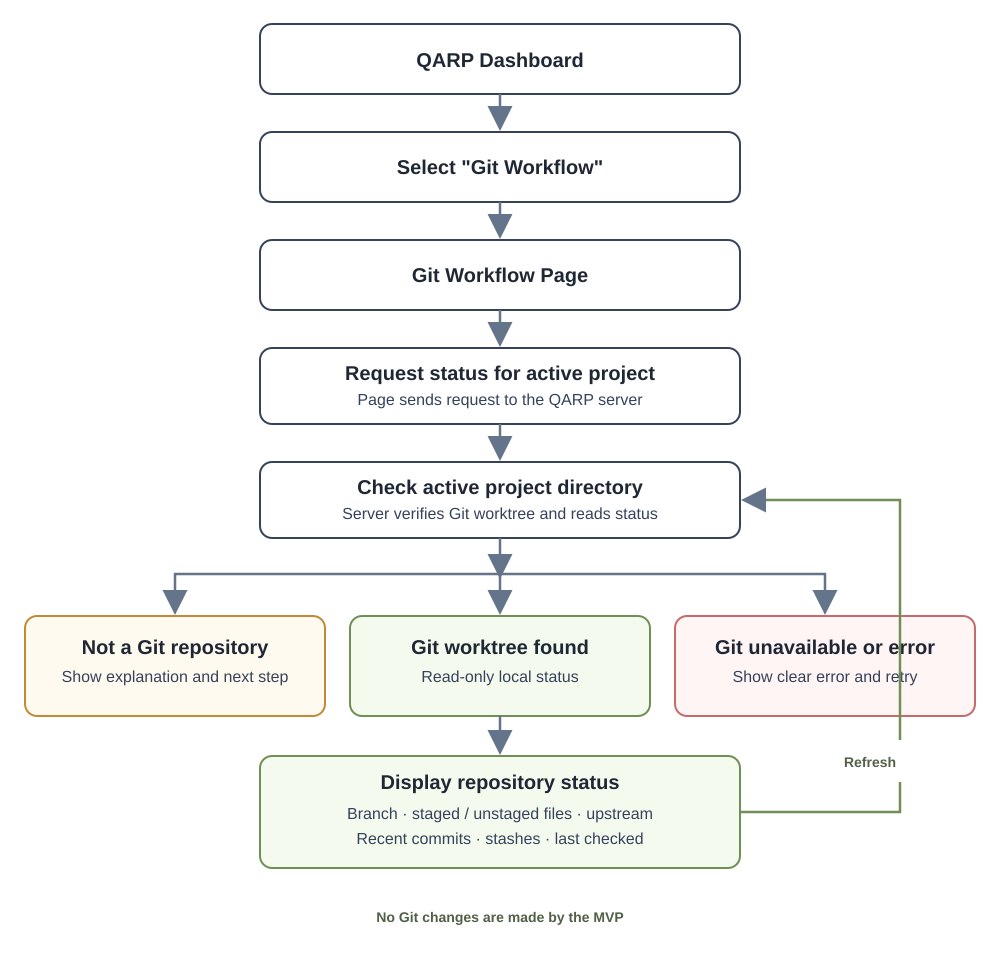

# Git Workflow Status Page — Assessment and Implementation Plan

## Purpose

Assess whether QARP needs a dedicated Git page and define a separate, incremental plan for showing the active project's live repository state. The supplied Git Workflow diagram is the reference for the concepts: working directory, staging area, local repository, remote repository, branch tracking, and stash.

This plan describes a read-only Git status page. Phase 1 has now been implemented; the page performs local inspection only and does not change repository state.

## Current project status

QARP already supports switching the active project and has a sidebar of links to standalone pages. This makes a dedicated Git page a natural fit: it can operate on the same active project while keeping repository operations separate from Playwright test execution.

Before implementation, the source review found no dedicated Git status page or API for live Git status. The Phase 1 implementation now adds both:

- The new page queries a read-only runner endpoint for status in the active project; it does not accept a project path from the browser.
- Its offline project-structure fallback supplies `gitBranch: 'main'`. This is placeholder data, not a live Git check, and must not be presented as the active branch.
- The dashboard contains a hidden Git branch badge, but it does not provide a complete Git status or workflow interface.
- QARP already has a precedent for standalone tools: Project Analyzer and Walkthrough Recorder are separate pages linked from the dashboard.

**Assessment:** a dedicated Git Workflow page is warranted if the goal is to inspect real repository state and guide common Git tasks. The server must read repository state from the active project on demand; the browser should not simulate status or infer it from test-run data.

**Implementation note:** the Git Workflow page and sidebar link are available; the server uses fixed Git argument lists without a shell, disables optional index writes and fsmonitor, bounds command time and output, and never fetches a remote. Unit tests cover porcelain status parsing.

## Git workflow in plain text

The MVP does not stage, commit, fetch, pull, push, switch branches, reset, clean, or stash changes.

## Recommended product scope

### Phase 1 — Live, read-only status page (MVP)

Add a **Git Workflow** link to the QARP sidebar and a standalone page that displays:

- Active project name/path and whether it is inside a Git worktree.
- Current branch and detached-HEAD state.
- Working-tree changes grouped as modified, added, deleted, renamed, and untracked.
- Staged and unstaged changes as distinct groups.
- Upstream branch and ahead/behind counts, when an upstream exists.
- Recent local commit summaries, with author and date.
- Stash count and concise stash summaries.
- A refresh action and a clear last-checked timestamp.

The page should explain useful concepts from the diagram with labels or a simple status flow. It should distinguish local status from remote status: ahead/behind counts depend on the locally known upstream state and may be stale until fetched.

Phase 1 is strictly read-only. It must not run `git fetch`, stage, commit, push, pull, checkout, reset, clean, or stash commands.

### Phase 2 — Safe inspection aids

After the read-only page is stable, consider:

- Viewing a bounded, text-only diff for selected files.
- Copying safe Git commands for the user to run in a terminal.
- A fetch action only if its network side effects and authentication behavior are made explicit.

Diff content should be bounded and should not render as HTML. Binary files, very large diffs, and unreadable content need clear handling.

### Phase 3 — Explicitly confirmed Git actions (optional)

Only add write operations if separately approved and designed. Possible actions include staging selected files, unstaging, committing, pushing, pulling, and stash operations. Each action needs an explicit preview and confirmation, visible target branch/repository details, and clear error reporting.

Do not expose destructive or history-rewriting commands such as `reset --hard`, `clean`, force-push, or branch deletion through the UI. Do not silently auto-stage or auto-commit changes.

## Implementation plan

### 1. Define the status API contract

- Add a read-only endpoint for Git status in the active project.
- Return structured fields for repository detection, root, branch/HEAD, staged and unstaged file summaries, upstream, ahead/behind counts, recent commits, stash summaries, and last checked time.
- Represent expected states explicitly: not a Git repository, no upstream, detached HEAD, Git unavailable, and command failure.
- Do not return credentials, remote URLs containing embedded credentials, environment variables, or full repository configuration.
- Keep command output bounded and return structured errors instead of a success-shaped empty status.

### 2. Implement safe server-side Git inspection

- Use the already-selected active project root; do not accept an arbitrary path from the browser.
- Confirm that the directory exists and is a Git worktree before querying it.
- Invoke Git with a fixed allowlist of read-only arguments via `child_process.execFile` (or the repository's established safe process helper), never by interpolating browser input into a shell command.
- Apply timeouts and output-size limits. Handle Git not installed, command timeout, invalid repository, and detached-HEAD cases explicitly.
- Parse machine-readable output (for example, porcelain status and NUL-delimited paths) so filenames containing spaces or unusual characters are represented correctly.
- Do not fetch or contact a remote during status refresh. Mark upstream divergence as based on the locally available tracking refs.

### 3. Add the separate page and navigation

- Create `pages/git-workflow.html` using the existing standalone page conventions.
- Add a Git Workflow link to the dashboard's Quick Links, with a clear title and icon.
- Show loading, refreshed, empty/clean, non-repository, unavailable, and error states.
- Refresh on page load and on user request. Avoid tight polling; if periodic refresh is later added, make its interval conservative and stop it when the page is hidden.
- Make repository paths and filenames text-only DOM content; do not inject Git output as HTML.
- Keep the page responsive and usable with keyboard navigation and screen readers.

### 4. Test and validate

- Add unit tests for status parsing, including spaces, Unicode, renames, untracked files, staged/unstaged changes, detached HEAD, and clean worktrees.
- Add server tests for repository missing, Git executable missing, timeout, malformed output, and output bounds.
- Verify the endpoint cannot be directed to an arbitrary filesystem path and that request values cannot become shell syntax.
- Verify remote URLs and any credential-like values are not exposed in the response.
- Add page tests for loading, refresh, clean state, error states, and accessible status labels.
- Run the existing unit suite and the targeted new tests; verify manually in a temporary local Git repository with no remote network access.

## Acceptance criteria

- The page shows live status for the current active project, not placeholder branch data.
- Staged, unstaged, and untracked changes are distinguished correctly.
- Branch and locally known upstream divergence are displayed accurately, or their absence is explained.
- A clean repository, non-Git directory, missing Git executable, and command failure all have clear distinct UI states.
- Refreshing status performs read-only local inspection and does not change the worktree or contact the remote.
- No command is constructed from unsanitized user input, and no credentials are exposed.
- Existing project switching, dashboard navigation, test execution, and theme behavior remain unchanged.

## Out of scope for the MVP

- GitHub account sign-in, tokens, pull-request management, or hosted repository APIs.
- Automatic fetch, push, pull, merge, rebase, or conflict resolution.
- Staging, committing, resetting, cleaning, or modifying files.
- Replacing a full Git client or teaching all Git concepts in the page.

## Recommendation

Proceed with **Phase 1 only** as the first implementation: a separate, live, read-only Git Workflow page tied to QARP's active project. This directly addresses the diagram while avoiding accidental file changes or remote-history updates. Decide on Phase 2 or Phase 3 only after reviewing the MVP and its safety behavior.
